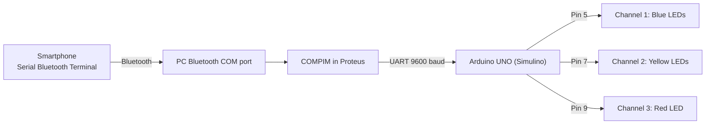

# Home Automation via Bluetooth using Arduino & Proteus

  

Designed and simulated a smart home automation system using Proteus and Arduino. The system remotely controls devices such as lights and fans through a Bluetooth mobile connection. Commands typed on a smartphone are received by the Arduino over a serial link, and each command switches one output ON or OFF.

---

##  Overview

Controlling home appliances from a phone is one of the most common IoT applications. This project builds and tests the complete idea in simulation before any hardware is purchased. A smartphone sends single-character commands over Bluetooth. A PC bridges the Bluetooth serial connection into Proteus through a COM port, where a simulated Arduino UNO reads each character and drives the matching output. LEDs represent the home devices (lights, fans, and so on).

##  Key Features

- **Wireless control:** commands are sent from a smartphone over Bluetooth.
- **Three independent channels:** each channel has its own ON and OFF command.
- **Simple protocol:** one ASCII character per command, easy to extend.
- **Complete simulation:** the circuit and the serial link are fully tested in Proteus, with no hardware needed.
- **Hardware-ready:** the same sketch runs on a real Arduino with a Bluetooth module and relays.

##  System Architecture



##  Components

| Component | Details |
|---|---|
| Microcontroller | Arduino UNO (Simulino UNO model in Proteus) |
| Outputs | 5 LEDs in 3 channels (red, yellow, blue, and two bi-color LEDs) representing home devices |
| Serial bridge | COMPIM (connects the simulation to a real PC COM port) |
| Test terminal | Proteus Virtual Terminal (connected to the Arduino TX/RX) |
| Phone app | Serial Bluetooth Terminal (Android) |
| Bluetooth  | [ Bluetooth COM port of the PC / HC-05 module ] |

##  Pin Mapping

| Arduino Pin | Variable | Connected to |
|---|---|---|
| 5 | `come` | Channel 1: blue LED (D2) and bi-color LED (D5) |
| 7 | `in` | Channel 2: yellow LED (D1) and bi-color LED (D4) |
| 9 | `on` | Channel 3: red LED (D3) |
| 0 (RX) / 1 (TX) | | Serial link to COMPIM and the Virtual Terminal |


##  Command Table

| Command | Action | Pin |
|---|---|---|
| `1` | Channel 1 **ON** | 5 |
| `0` | Channel 1 **OFF** | 5 |
| `2` | Channel 2 **ON** | 7 |
| `4` | Channel 2 **OFF** | 7 |
| `3` | Channel 3 **ON** | 9 |
| `6` | Channel 3 **OFF** | 9 |

> Note that the OFF commands are not the same pattern for every channel: Channel 1 uses `0`, Channel 2 uses `4`, and Channel 3 uses `6`.

##  Code Explanation


```cpp
int come = 5;   // Channel 1
int in   = 7;   // Channel 2
int on   = 9;   // Channel 3
char c;         // Last received character
```

**`setup()`** sets pins 5, 7, and 9 as outputs and starts the serial port at **9600 baud**.

**`loop()`** runs continuously:

1. `c = Serial.read();` reads one character from the serial buffer (it returns `-1` when nothing is received, which matches no command).
2. A chain of `if / else if` checks compares the character with the command table.
3. `digitalWrite(pin, HIGH)` turns an output on and `digitalWrite(pin, LOW)` turns it off.

```cpp
if (c == '1')      digitalWrite(come, HIGH);
else if (c == '0') digitalWrite(come, LOW);
```

Each channel keeps its state until the next command for that channel arrives.

##  Proteus Simulation Setup

| Setting | Value |
|---|---|
| Arduino program file | The compiled `.hex` exported from Arduino IDE |
| COMPIM physical port | [COMx] (the Bluetooth COM port of the PC) |
| COMPIM baud rate | 9600 |
| Virtual Terminal baud rate | 9600 |
| Data bits / Parity / Stop bits | 8 / None / 1 |

The Virtual Terminal is connected to the same serial lines, so you can also **type a command directly in it** to test the circuit without using the phone.

##  Phone Setup

1. Install **Serial Bluetooth Terminal** from Google Play.
2. Pair the phone with the PC's Bluetooth [ or with the HC-05 module ].
3. Open the app, choose the paired device, and tap **Connect**.
4. Type a command character from the table and press send.

##  How to Run

1. Open the sketch in **Arduino IDE 2.3.6**, select the board **Arduino UNO**, and use **Sketch → Export Compiled Binary** to get the `.hex` file.
2. Open the Proteus project `Simulation/[Home-Automation.pdsprj]`.
3. Double-click the Arduino, set **Program File** to the exported `.hex`.
4. Double-click COMPIM and set the COM port and baud rate as in the table above.
5. Start the simulation.
6. Connect the phone through the app and send commands.

### Quick Test

| Send | Expected result |
|---|---|
| `1` | Blue LEDs turn on |
| `0` | Blue LEDs turn off |
| `2` | Yellow LEDs turn on |
| `4` | Yellow LEDs turn off |
| `3` | Red LED turns on |
| `6` | Red LED turns off |

##  Results

The simulation confirmed that every command from the phone is received and applied immediately, and that the three channels work independently of one another.

##  Moving to Real Hardware

- Replace COMPIM with a Bluetooth module (**HC-05 or HC-06**): module TX to Arduino RX (pin 0) and module RX to Arduino TX (pin 1), through a voltage divider for the module's RX pin. Disconnect these wires while uploading code.
- Add a **220 Ω resistor** in series with each LED.
- Drive real lights and fans through **relay modules**, never directly from the Arduino pins.

##  Possible Improvements

- Use one consistent ON/OFF pattern (for example `1/0`, `2/3`, `4/5`).
- Check `Serial.available()` before reading, and call `Serial.begin(9600)` once.
- Send a confirmation message back to the phone after each command.
- Add a fan speed channel with PWM, or a temperature sensor.
- Build a custom Android app with buttons instead of typing characters.

##  Repository Structure

```
├── Code/
│   └── Arduino___Bluetooth.ino       # Arduino sketch
├── Simulation/
│   └── [Home-Automation.pdsprj]      # Proteus project
├── Images/
│   └── Circuit.png                   # Proteus circuit
└── README.md
```

##  Skills Demonstrated

- Arduino programming (C/C++)
- Serial (UART) communication and command parsing
- Bluetooth wireless control from a mobile app
- Circuit design and simulation with Proteus
- Home automation concepts


